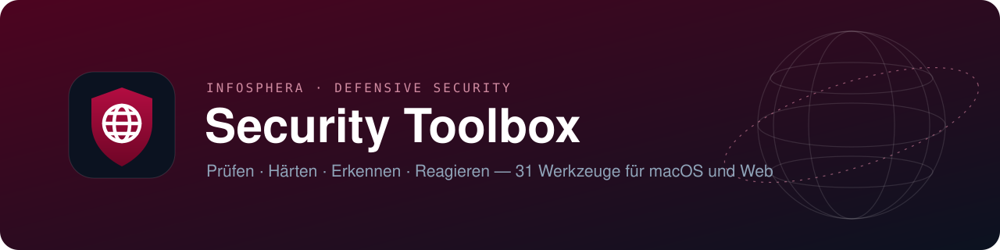
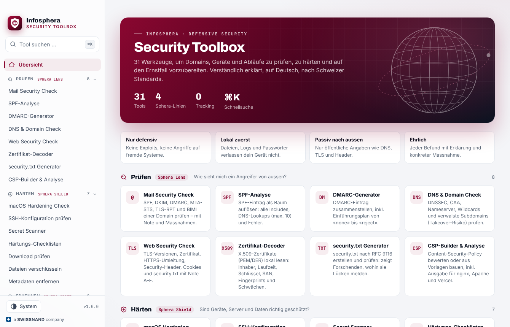
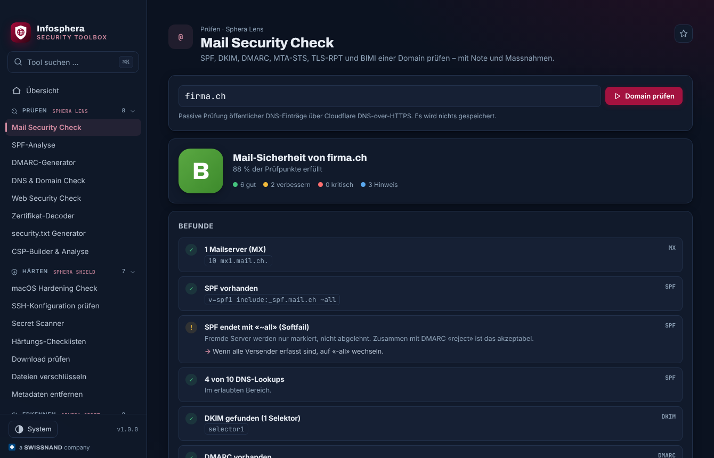
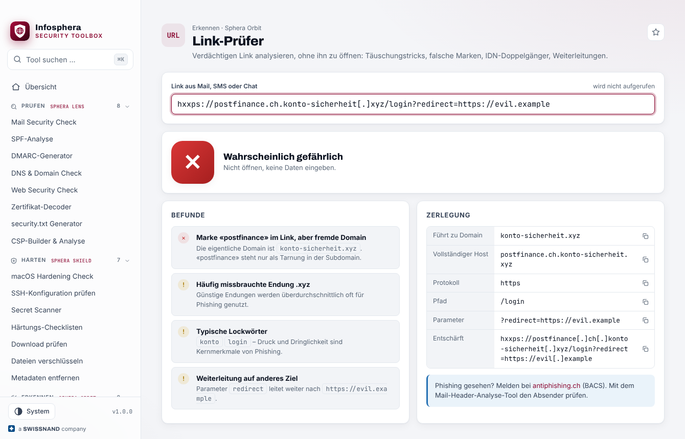
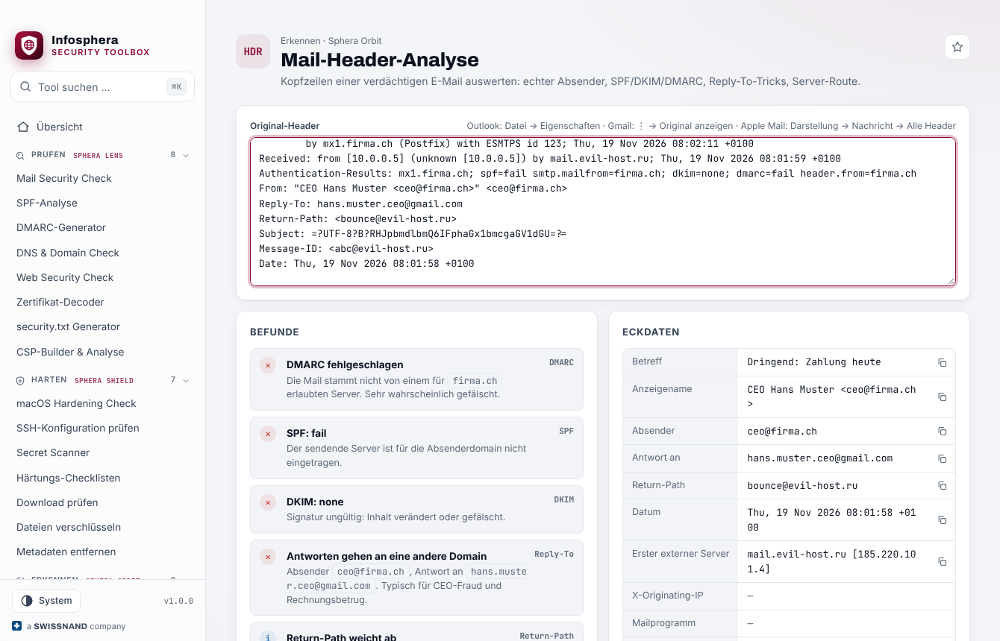
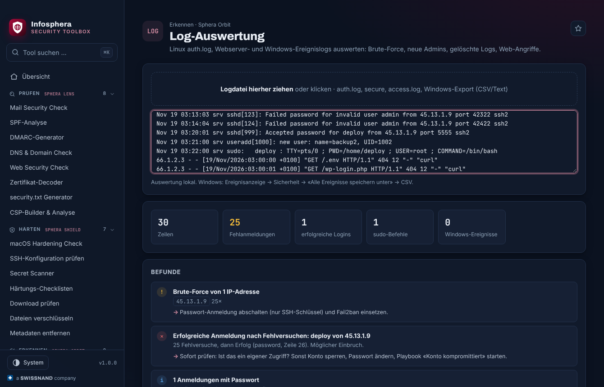
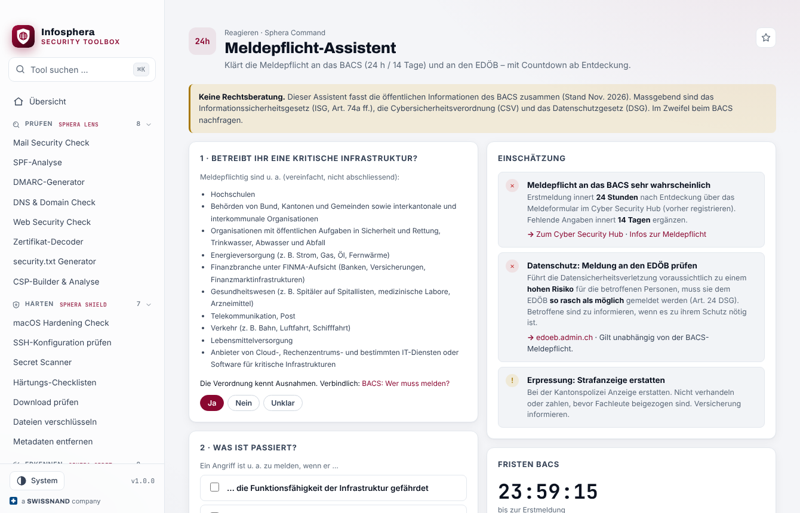
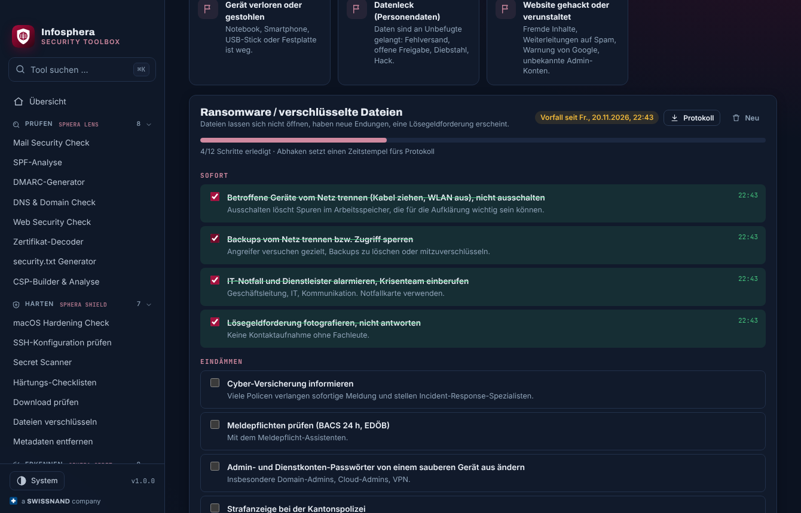

<div align="center">

<picture>
  <source media="(prefers-color-scheme: dark)" srcset="assets/banner-dark.svg">
  <source media="(prefers-color-scheme: light)" srcset="assets/banner-light.svg">
  
</picture>

<br><br>

[](https://github.com/swissnand/security-toolbox/releases/latest)
[](https://swissnand.github.io/security-toolbox/)


**Defensive Security-Werkzeuge für Organisationen ohne eigenes Security-Team.**
<br>Domain prüfen, Geräte härten, Phishing erkennen, im Ernstfall richtig reagieren. Verständlich erklärt, auf Deutsch, nach Schweizer Standards.

</div>

---

## ✦ Was die Toolbox ausmacht

<table>
<tr>
<td width="25%" valign="top">

### 🛡 Nur defensiv
Keine Exploits, keine Scans fremder Systeme. Nach aussen nur passive Abfragen öffentlicher Angaben (DNS, TLS, Header).

</td>
<td width="25%" valign="top">

### 🔒 Lokal zuerst
Logs, Dateien, Passwörter und Header werden **auf deinem Gerät** ausgewertet. Kein Konto, kein Tracking, keine Cloud.

</td>
<td width="25%" valign="top">

### 🇨🇭 Schweizer Kontext
Meldepflicht an das BACS (24 h), Datenschutz nach DSG, IKT-Minimalstandard, Schweizer Meldestellen.

</td>
<td width="25%" valign="top">

### 💬 Ehrlich erklärt
Jeder Befund mit Bedeutung und konkreter Massnahme. Note A–F, Bericht als Markdown exportierbar.

</td>
</tr>
</table>

## 📸 Screenshots

<picture>
  <source media="(prefers-color-scheme: dark)" srcset="assets/screenshots/home-dark.png">
  
</picture>

<table>
<tr>
<td><p align="center"><sub>Mail Security Check mit Note und Massnahmen</sub></p></td>
<td><p align="center"><sub>Link-Prüfer: Phishing erkennen, ohne zu klicken</sub></p></td>
</tr>
<tr>
<td><p align="center"><sub>Mail-Header-Analyse gegen CEO-Fraud</sub></p></td>
<td><p align="center"><sub>Log-Auswertung: Brute-Force und Einbruch erkennen</sub></p></td>
</tr>
<tr>
<td><p align="center"><sub>Meldepflicht-Assistent mit 24-h-Countdown</sub></p></td>
<td><p align="center"><sub>Incident Playbooks mit Zeitstempeln</sub></p></td>
</tr>
</table>

## 📥 Installation

1. Neueste **`.dmg`** bei den [Releases](https://github.com/swissnand/security-toolbox/releases/latest) herunterladen (Universal: läuft auf Apple Silicon und Intel).
2. DMG öffnen und **Infosphera Security Toolbox** in den Ordner **Programme** ziehen.
3. Beim ersten Start: **Rechtsklick auf die App → Öffnen → Öffnen**.

> [!NOTE]
> Die App ist Open Source, aber (noch) nicht von Apple notarisiert. Darum fragt macOS beim ersten Start nach. Falls «App ist beschädigt» erscheint, hilft im Terminal:
> ```bash
> xattr -cr "/Applications/Infosphera Security Toolbox.app"
> ```

**Ohne Installation:** Die meisten Tools laufen auch im Browser unter **[swissnand.github.io/security-toolbox](https://swissnand.github.io/security-toolbox/)**. Ausnahmen: Web Security Check (Live-Abruf) und macOS Hardening Check brauchen die App, weil Browser fremde Header, Zertifikate und Systemeinstellungen nicht auslesen dürfen.

## 🧰 Alle Tools

Die Tools folgen den vier Produktlinien von Infosphera.

<details open>
<summary><b>Prüfen · Sphera Lens</b> · 8 Tools · <i>Wie sieht mich ein Angreifer von aussen?</i></summary>

| Tool | Beschreibung |
|---|---|
| **Mail Security Check** | SPF, DKIM, DMARC, MTA-STS, TLS-RPT, BIMI und DNSSEC einer Domain mit Note A–F und Massnahmen. |
| **SPF-Analyse** | SPF-Eintrag als Baum auflösen, DNS-Lookups zählen (max. 10), Fehler finden. |
| **DMARC-Generator** | DMARC-Eintrag zusammenstellen, bestehenden laden, Einführungsplan von «none» bis «reject». |
| **DNS & Domain Check** | Nameserver, DNSSEC, CAA, Wildcards und verwaiste Subdomains mit Takeover-Risiko. |
| **Web Security Check** | TLS-Versionen, Zertifikat, HTTPS-Umleitung, Security-Header, Cookies, security.txt, Mixed Content. *(App)* |
| **Zertifikat-Decoder** | X.509 (PEM/DER, auch Ketten) lokal lesen: Inhaber, Laufzeit, Schlüssel, SAN, Fingerprints, Schwächen. |
| **security.txt Generator** | Datei nach RFC 9116 erstellen und bestehende prüfen. |
| **CSP-Builder & Analyse** | Content-Security-Policy bewerten oder aus Vorlagen bauen, Ausgabe für nginx, Apache, Vercel. |

</details>

<details open>
<summary><b>Härten · Sphera Shield</b> · 7 Tools · <i>Sind Geräte, Server und Daten richtig geschützt?</i></summary>

| Tool | Beschreibung |
|---|---|
| **macOS Hardening Check** | FileVault, Firewall, Gatekeeper, SIP, Updates, Bildschirmsperre, Freigaben. Nur lesend, ohne Admin-Passwort. *(App)* |
| **SSH-Konfiguration prüfen** | sshd_config bewerten: Root-Login, Passwörter, schwache Algorithmen, Weiterleitungen. |
| **Secret Scanner** | API-Keys, Tokens, private Schlüssel und Passwörter in Projektordnern finden (AWS, GitHub, Stripe, Supabase …). |
| **Härtungs-Checklisten** | KMU-Grundschutz, macOS, Windows, Linux, M365/Google, Netzwerk, Website. Abhaken mit Datum, Export. |
| **Download prüfen** | Prüfsumme (SHA-256/512/1) einer Datei mit dem Herstellerwert vergleichen. |
| **Dateien verschlüsseln** | AES-256-GCM mit Passwort (PBKDF2, 600 000 Runden), Dateiname mitverschlüsselt. |
| **Metadaten entfernen** | GPS-Standort, Kamera, Datum und Kommentare aus JPEG/PNG entfernen, ohne Qualitätsverlust. |

</details>

<details open>
<summary><b>Erkennen · Sphera Orbit</b> · 8 Tools · <i>Ist etwas faul? Bin ich betroffen?</i></summary>

| Tool | Beschreibung |
|---|---|
| **Passwort-Leak-Check** | Prüft gegen Have I Been Pwned per k-Anonymity. Das Passwort verlässt das Gerät nie. |
| **Lookalike-Domains** | Tippfehler- und Doppelgänger-Domains erzeugen und prüfen, welche registriert sind und Mail empfangen. |
| **Link-Prüfer** | Verdächtige Links analysieren, ohne sie zu öffnen: Marken-Tarnung, IDN-Homographen, @-Trick, Weiterleitungen. |
| **Mail-Header-Analyse** | Echter Absender, SPF/DKIM/DMARC-Ergebnis, Reply-To-Tricks, Server-Route mit Zeiten. |
| **IOC-Extraktor** | IPs, Domains, URLs, Hashes, E-Mails, CVEs und ATT&CK-IDs aus Text ziehen, entschärfen, exportieren. |
| **Log-Auswertung** | auth.log, Webserver- und Windows-Logs: Brute-Force, Login nach Fehlversuchen, neue Admins, gelöschte Logs. |
| **CVSS-3.1-Rechner** | Basiswert berechnen oder Vektor-String entschlüsseln. |
| **CVE-Suche** | Beschreibung, CVSS, aktive Ausnutzung (CISA KEV), betroffene Produkte und Patches aus der NVD. |

</details>

<details open>
<summary><b>Reagieren · Sphera Command</b> · 5 Tools · <i>Was tun wir im Ernstfall, wer meldet was bis wann?</i></summary>

| Tool | Beschreibung |
|---|---|
| **Cyber-Quick-Check** | 15 Fragen nach den fünf Funktionen des IKT-Minimalstandards, Reifegrad und Top-Massnahmen. |
| **Notfallkarte** | Eine Seite für den Ernstfall mit ersten Schritten und Notfallnummern. Drucken oder als PDF speichern. |
| **Meldepflicht-Assistent** | Meldepflicht an das BACS (24 h / 14 Tage) und den EDÖB klären, mit Countdown ab Entdeckung. |
| **Incident Playbooks** | Ransomware, Kontoübernahme, Phishing-Klick, Zahlungsbetrug, Geräteverlust, Datenleck, gehackte Website. |
| **Vorfall-Logbuch** | Alles mit Zeitstempel festhalten, Export als Markdown oder CSV für Versicherung und Behörden. |

</details>

<details>
<summary><b>Wissen</b> · 3 Tools</summary>

| Tool | Beschreibung |
|---|---|
| **Security-Glossar** | 50 Begriffe verständlich auf Deutsch, von 2FA bis Zero Trust. |
| **Riskante Ports** | Welche Dienste gehören nie ins Internet? Mit Risiko-Einstufung. |
| **Meldestellen & Hilfe** | BACS, Polizei, EDÖB, antiphishing.ch und weitere Anlaufstellen. |

</details>

## 🌐 Welche Verbindungen die App aufbaut

Transparenz ist Teil der Sicherheit. Die App verbindet sich **nur**, wenn du ein Tool startest, das dafür gebaut ist:

| Ziel | Wofür | Was übertragen wird |
|---|---|---|
| `cloudflare-dns.com` | DNS-Abfragen (Mail, DNS, SPF, DMARC, Lookalikes) | der abgefragte Domainname |
| `api.pwnedpasswords.com` | Passwort-Leak-Check | die ersten 5 Zeichen des SHA-1-Hashs, nie das Passwort |
| `services.nvd.nist.gov` | CVE-Suche | die CVE-Nummer |
| die geprüfte Website | Web Security Check, MTA-STS, security.txt | ein normaler Seitenabruf wie im Browser *(nur App)* |

Alles andere läuft offline. Es gibt keine Telemetrie, keine Analytics und keine Updates im Hintergrund.

## ⌨️ Tastenkürzel

| Kürzel | Aktion |
|---|---|
| <kbd>⌘</kbd> <kbd>K</kbd> | Schnellsuche |
| <kbd>⌘</kbd> <kbd>0</kbd> | Übersicht |
| <kbd>⌘</kbd> <kbd>⇧</kbd> <kbd>N</kbd> | Notfallkarte |
| <kbd>⌘</kbd> <kbd>⇧</kbd> <kbd>P</kbd> | Incident Playbooks |
| ★ oben rechts | Tool als Favorit markieren |

## 🛠 Selbst bauen

Voraussetzung: [Node.js](https://nodejs.org) 20 oder neuer.

```bash
git clone https://github.com/swissnand/security-toolbox.git
cd security-toolbox
npm install
npm start            # App im Entwicklungsmodus starten
npm run dist         # DMG bauen → liegt danach in dist/
```

Die Web-Version ohne Electron: `npm run web` und dann <http://localhost:8080> öffnen.

### Automatische Releases

Sobald die Versionsnummer in `package.json` erhöht und auf `main` hochgeladen wird, baut GitHub die DMG auf einem macOS-Server und veröffentlicht sie als Release. Alternativ per Tag:

```bash
git tag v1.0.0
git push origin v1.0.0
```

## 🧩 Eigenes Tool hinzufügen

Jedes Tool ist ein Objekt in `src/js/tools/<linie>.js`:

```js
TB.register({
  id: 'mein-check',
  name: 'Mein Check',
  glyph: 'MC',                 // Kürzel im Icon
  cat: 'lens',                 // lens | shield | orbit | command | reference
  desc: 'Was das Tool prüft.',
  keywords: 'suchbegriffe für ⌘K',
  render(root, U) {
    root.innerHTML = `<div class="panel"><input id="in"><div id="out"></div></div>`;
    U.q('#in').oninput = (e) => {
      U.q('#out').innerHTML = U.findings([{ s: 'ok', t: 'Alles gut', d: 'Erklärung', fix: 'Massnahme' }]);
    };
  },
});
```

`U` liefert Helfer wie `findings()`, `gradeBox()`, `net.doh()`, `net.probe()`, `dropzone()`, `kv()`, `copy()`, `download()` und `store`. Kein Framework, kein Build-Schritt.

**Regel für neue Tools:** Nur defensiv. Aktive Prüfungen fremder Systeme (Port-Scans, Login-Versuche, Exploits) werden nicht aufgenommen.

## 📁 Projektstruktur

```
security-toolbox/
├── main.js              Electron-Hauptprozess (Fenster, Menü, HTTP/TLS-Abruf, Mac-Check)
├── preload.js           Schmale Brücke: 4 lesende Funktionen, kein Node-Zugriff
├── src/
│   ├── index.html       App-Shell
│   ├── css/style.css    Infosphera-Design (Weinrot #8A0730 auf Nachtblau, Dark/Light)
│   ├── fonts/           Archivo, Inter, JetBrains Mono (OFL, lokal)
│   ├── js/core.js       Registry, Befunde, Noten, DNS-over-HTTPS, Helfer
│   ├── js/app.js        Navigation, Suche, Favoriten, Design
│   └── js/tools/        lens · shield · orbit · command · reference
├── build/               App-Icon und DMG-Hintergrund
└── .github/workflows/   DMG-Build und GitHub Pages
```

## 🔐 Sicherheit der App selbst

- `contextIsolation`, `sandbox` und keine Node-Integration im Renderer
- Strikte Content-Security-Policy, Netzwerk nur zu den oben genannten Zielen
- Hauptprozess erlaubt nur `http`/`https`-GET, keine Cookies, Antwortgrösse begrenzt
- Mac-Check führt nur fest definierte, lesende Befehle aus (kein Shell-Aufruf, keine Benutzereingaben)
- Krypto über die WebCrypto-API (AES-256-GCM, PBKDF2, SHA-2)

Eine Lücke gefunden? Siehe [SECURITY.md](SECURITY.md).

## ⚖️ Hinweis

Die Toolbox ersetzt keine Fachberatung. Der Meldepflicht-Assistent fasst öffentliche Informationen des BACS zusammen und ist keine Rechtsberatung. Massgebend sind ISG, Cybersicherheitsverordnung und DSG.

---

<div align="center">
<sub><b>Infosphera</b> · Built in Switzerland. Responsibly, and within the law.<br>a <a href="https://swissnand.com"><b>SWISSNAND</b></a> company · <a href="https://infosphera.swissnand.com">infosphera.swissnand.com</a> · MIT-Lizenz</sub>
</div>
